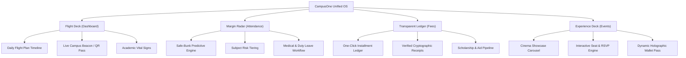
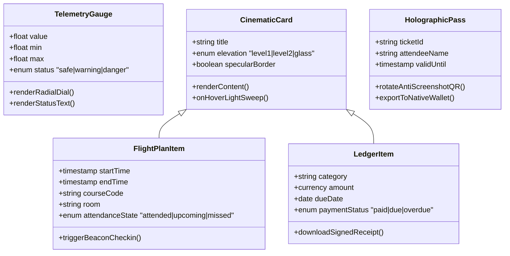
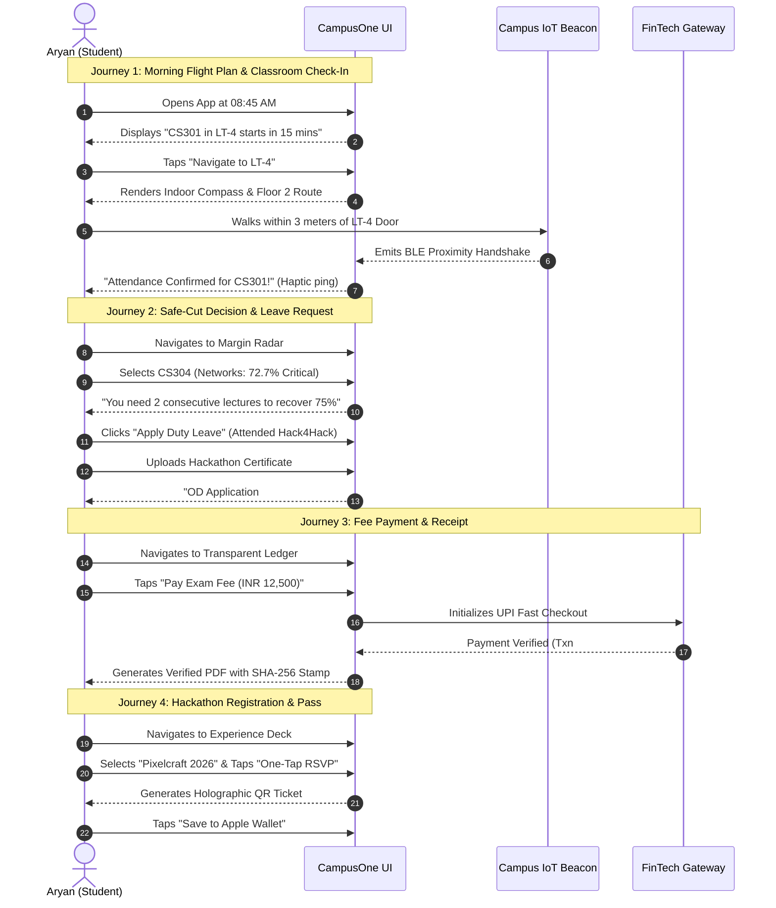

# CampusOne — Design System & Product Specification
**Hack4Hack Pixelcraft 2026 — Design Brief DS-05**  
*Document Version: 1.0.0 (Release-Ready)*  
*Design Direction: Premium Cinematic / Instrument-Grade Spatial Clarity*  
*Target Persona: University Students, Class Representatives, Campus Administrators*  

---

## Executive Summary & Design Vision

**CampusOne** is engineered as a unified academic and lifestyle operating system. University apps historically suffer from fragmented portals, cluttered ERP tables, high cognitive load, and aggressive visual noise. CampusOne reimagines the collegiate experience through the lens of **high-end instrument design** (inspired by the tactile precision of Teenage Engineering, the contextual speed of Linear, and the atmospheric depth of Apple visionOS/macOS dark interfaces).

### Core Design Philosophy: "Cinematic Precision"
1. **Clarity Over Decoration**: Atmospheric glows, frosted glass, and volumetric borders are not decorative novelties—they serve as strict depth indices, visual hierarchy anchors, and focus conduits.
2. **Actionable Telemetry**: Raw numbers are converted into actionable student intelligence. (e.g., Attendance is not just "78.4%", but *"Safe: You can skip 2 lectures in CS301 without dipping below 75%"*).
3. **Calm Under Pressure**: Examination schedules, overdue fees, and attendance alerts use reassuring, high-contrast semantic indicators that mitigate student anxiety while delivering unmistakable urgency when critical.

---



---

## 1. Brand Identity & Visual Language

### 1.1 Brand Archetype & Personality
- **Archetype**: *The Polished Visionary & Precision Instrument*.
- **Brand Attributes**:
  - **Atmospheric & Immersive**: Dark obsidian canvases paired with deep spectral refractions that feel alive yet unobtrusive.
  - **Calibrated & Scientific**: Strict alignment, monospace data telemetry, and predictable spatial physics.
  - **Empowering & Trustworthy**: Zero deceptive patterns, absolute financial transparency, and instant academic status clarity.

### 1.2 The Visual Language: "Obsidian Luminescence"
- **Volumetric Layering**: The UI is composed of 4 discrete spatial strata:
  - *Layer 0 (Void Canvas)*: Deepest space `#07090E` with subtle radial light falloff.
  - *Layer 1 (Tectonic Surface)*: `#0E131F` with 1px specular micro-borders (`rgba(255, 255, 255, 0.06)`).
  - *Layer 2 (Elevated Instrument)*: `#161D2E` with 1px inner ambient rim highlight (`inset 0 1px 0 rgba(255, 255, 255, 0.10)`).
  - *Layer 3 (Floating Membrane)*: Glassmorphic frost (`rgba(22, 29, 46, 0.72)` + `backdrop-filter: blur(24px) saturate(180%)`).
- **Tactile Light Physics**: Border lines do not use flat solid grays; they employ directional gradient strokes that simulate an overhead luminescent source (light falling from top-center).

---

## 2. Colour Palette & Typography System

### 2.1 The Semantic Color Architecture
All tokens are strictly calibrated against WCAG 2.2 Level AA / AAA contrast standards over `#07090E`.

```
=======================================================================================
Token Name              Hex Code        RGB / RGBA                 Role / Usage
=======================================================================================
--canvas-void           #07090E         rgb(7, 9, 14)              Root background
--canvas-surface-1      #0E131F         rgb(14, 19, 31)            Primary card surface
--canvas-surface-2      #161D2E         rgb(22, 29, 46)            Elevated surface / hover
--canvas-surface-3      #1F293F         rgb(31, 41, 63)            Floating sheets / flyouts
--canvas-glass          rgba(...)       rgba(14, 19, 31, 0.72)     Backdrop blur container

--brand-cyan            #00F2FE         rgb(0, 242, 254)           Primary focus / Hero accent
--brand-cyan-glow       rgba(...)       rgba(0, 242, 254, 0.18)    Luminescent drop-shadow
--brand-iris            #7B61FF         rgb(123, 97, 255)          Secondary accent / Lifestyle
--brand-rose            #F43F5E         rgb(244, 63, 94)           Tertiary energetic accent

--semantic-safe         #10B981         rgb(16, 185, 129)          Attendance >80%, Paid dues
--semantic-safe-dim     rgba(...)       rgba(16, 185, 129, 0.12)   Safe chip background
--semantic-warn         #F59E0B         rgb(245, 158, 11)          Attendance 75%-79%, Due in 48h
--semantic-warn-dim     rgba(...)       rgba(245, 158, 11, 0.12)   Warning badge background
--semantic-danger       #EF4444         rgb(239, 68, 68)           Attendance <75%, Overdue fees
--semantic-danger-dim   rgba(...)       rgba(239, 68, 68, 0.14)    Critical alarm surface

--text-primary          #F8FAFC         rgb(248, 250, 252)         Headings, critical data (15.8:1)
--text-secondary        #94A3B8         rgb(148, 163, 184)         Body text, labels (7.4:1)
--text-muted            #64748B         rgb(100, 116, 139)         Timestamps, metadata (4.8:1)
--text-disabled         #334155         rgb(51, 65, 85)            Inactive buttons, placeholders

--border-subtle         rgba(...)       rgba(255, 255, 255, 0.07)  Standard card divider
--border-specular       rgba(...)       rgba(255, 255, 255, 0.14)  Elevated border
--border-active         rgba(...)       rgba(0, 242, 254, 0.50)    Focus indicator / Active tab
=======================================================================================
```

### 2.2 Typography Hierarchy

We pair **Plus Jakarta Sans** (clean, friendly geometric sans for high-readability body & headings) with **JetBrains Mono** (precision tabular mono for grades, percentages, room codes, timestamps, and ledger balances).

```
========================================================================================
Style Name       Font Family          Size / Line-Height    Weight     Tracking  Numbers
========================================================================================
Display Hero     Plus Jakarta Sans    36px / 44px (1.22)    700 Bold   -0.025em  Proportional
Heading 1        Plus Jakarta Sans    28px / 36px (1.28)    700 Bold   -0.020em  Proportional
Heading 2        Plus Jakarta Sans    22px / 28px (1.27)    600 SB     -0.015em  Proportional
Heading 3        Plus Jakarta Sans    18px / 24px (1.33)    600 SB     -0.010em  Proportional
Body Large       Plus Jakarta Sans    16px / 24px (1.50)    500 Med     0.000em  Proportional
Body Regular     Plus Jakarta Sans    14px / 20px (1.42)    400 Reg     0.000em  Proportional
Body SemiBold    Plus Jakarta Sans    14px / 20px (1.42)    600 SB      0.000em  Proportional
Caption          Plus Jakarta Sans    12px / 16px (1.33)    500 Med    +0.010em  Proportional
Micro Label      Plus Jakarta Sans    10px / 14px (1.40)    700 Bold   +0.040em  Proportional (UPPER)
Data Display     JetBrains Mono       24px / 28px (1.16)    600 SB     -0.010em  Tabular (tnum)
Data Body        JetBrains Mono       14px / 18px (1.28)    500 Med     0.000em  Tabular (tnum)
Data Micro       JetBrains Mono       11px / 14px (1.27)    500 Med    +0.020em  Tabular (tnum)
========================================================================================
```

---

## 3. Design Tokens & Spacing System

### 3.1 8-Point Spatial Grid
- Base unit: `4px` (micro), `8px` (standard container).
- Spatial rhythm:
  - `space-1`: 4px (micro margins, icon-text gap)
  - `space-2`: 8px (dense chips, nested padding)
  - `space-3`: 12px (badge spacing, list items)
  - `space-4`: 16px (card inner padding, input fields)
  - `space-5`: 20px (card inner padding for spacious desktop view)
  - `space-6`: 24px (section padding, grid gutter)
  - `space-8`: 32px (major layout section gap)
  - `space-12`: 48px (screen margin top / desktop hero gap)
  - `space-16`: 64px (desktop layout container padding)

### 3.2 Corner Radii Tokens
- `--radius-xs`: 4px (tags, micro pills, tooltip corners)
- `--radius-sm`: 8px (buttons, input fields, badge pills)
- `--radius-md`: 12px (nested inner cards, drop-down menus)
- `--radius-lg`: 16px (standard cards, telemetry containers)
- `--radius-xl`: 24px (modal sheets, hero banners, floating docks)
- `--radius-pill`: 9999px (circular action pills, status dots)

### 3.3 Atmospheric Depth & Elevation Tokens
- `--shadow-depth-1`: `0 2px 8px -2px rgba(0, 0, 0, 0.5), inset 0 1px 0 0 rgba(255, 255, 255, 0.06)`
- `--shadow-depth-2`: `0 8px 24px -4px rgba(0, 0, 0, 0.65), 0 2px 6px -1px rgba(0, 0, 0, 0.4), inset 0 1px 0 0 rgba(255, 255, 255, 0.10)`
- `--shadow-glow-cyan`: `0 0 32px -4px rgba(0, 242, 254, 0.22), 0 8px 20px -2px rgba(0, 0, 0, 0.5)`
- `--shadow-glow-danger`: `0 0 28px -4px rgba(239, 68, 68, 0.25)`

---

## 4. Navigation Architecture & Shell Design

### 4.1 Global Information Hierarchy
CampusOne utilizes a dual-mode navigation structure tailored for instantaneous one-handed mobile navigation and ultra-productive desktop telemetry.

```
CampusOne Root
├── Global Utilities (Top Bar Desktop / App Bar Mobile)
│   ├── Quick Profile & Academic Identity (Roll No, Semester)
│   ├── Global Command Search (Cmd+K / Spotlight)
│   ├── Dynamic Campus Beacon (NFC/QR Gate Pass quick access)
│   └── Real-Time Notifications Hub (Urgent alerts, schedule shifts)
│
├── 4 Primary Screen Nodes (Always 1 Click Away)
│   ├── [1] Flight Deck (Dashboard)
│   ├── [2] Margin Radar (Attendance)
│   ├── [3] Transparent Ledger (Fees)
│   └── [4] Experience Deck (Events)
│
└── Contextual Modals & Drawers
    ├── Quick Safe-Bunk Calculator
    ├── Razorpay/Stripe Instant Pay Drawer
    ├── Verified Dynamic Event Ticket Pass (Apple/Google Wallet)
    └── Classroom AR/Indoor Map Navigation
```

### 4.2 Mobile Navigation: The Floating Cinematic Glass Dock
- Position: Fixed at bottom, 16px above safe area inset.
- Dimensions: Width 92% of screen, max-width 380px, height 64px.
- Material: `rgba(14, 19, 31, 0.85)` + `backdrop-filter: blur(28px)` + `border: 1px solid rgba(255, 255, 255, 0.12)`.
- Ergonomics: Thumb-reachable touch targets (minimum 54px x 48px), haptic feedback triggers on selection.
- Active Indicator: Luminescent cyan pill with spring-physics motion sliding underneath the active tab icon and label.

### 4.3 Desktop Navigation: The Tactical Command Sidebar
- Left rail, fixed width 260px (collapsible to 76px compact icon mode).
- Features live student profile card at base, active semester switcher at top, and persistent keyboard shortcut badges (`[1]`, `[2]`, `[3]`, `[4]`, `[Cmd+K]`).

---

## 5. Four Required Screens: Full Architecture & Layout

### 5.1 Screen 1: Dashboard ("The Flight Deck")
The flight deck provides an omniscient, stress-free morning-to-night briefing.

```
+-----------------------------------------------------------------------------------+
| [CAMPUSONE]  Search courses, rooms, passes (Cmd+K)        [Beacon: Active] [User] |
+-----------------------------------------------------------------------------------+
| HERO GREETING & NEXT ACTION BANNER                                                |
| "Good Morning, Aryan. Next: Operating Systems (CS301) in Room LT-4 in 18 Mins"    |
| [Show Indoor Route] [Digital ID Gate Pass]                                        |
+-----------------------------------------------------------------------------------+
| 4-COLUMN TELEMETRY RIBBON                                                         |
| +-----------------+ +-----------------+ +-----------------+ +-----------------+  |
| | ATTENDANCE      | | CGPA / RANK     | | PENDING DUES    | | ACTIVE TICKETS  |  |
| | 82.4% (Healthy) | | 8.94 (Top 5%)   | | INR 0 (Cleared) | | 2 Passes Valid  |  |
| | Safe Margin: +2 | | 54 / 60 Credits | | Next: Semester 6| | Hack4Hack Next  |  |
| +-----------------+ +-----------------+ +-----------------+ +-----------------+  |
+-----------------------------------------------------------------------------------+
| TWO-COLUMN MAIN WORKSPACE                                                         |
| COLUMN 1: Today's Flight Plan (Schedule)    | COLUMN 2: Contextual Pulse          |
| - 09:00 - 10:15 | CS301 Operating Systems   | - Campus Facilities Status:         |
|   Prof. Rao | LT-4 | [Attended]             |   * Central Library: 42% Busy       |
| - 10:30 - 11:45 | CS304 Computer Networks   |   * Cafeteria: High Rush            |
|   Prof. Smith | Lab 2 | [Starts in 18m]    |   * High-Speed Wi-Fi: 420 Mbps      |
| - 12:30 - 01:15 | Lunch Break               | - Priority Campus Notices:          |
| - 02:00 - 03:30 | Design Systems Studio     |   * Midterm Hall Tickets Released   |
|   Auditorium A | Project Submission Due     |   * Pixelcraft Hackathon Check-in   |
+-----------------------------------------------------------------------------------+
```

#### Key Functional Innovations:
- **Time-Aware Header**: Shifts tone dynamically (Morning Briefing -> Afternoon Momentum -> Evening Wrap-up).
- **Proximity Gate Beacon**: NFC/BLE card emulator for physical gate entry, turnstiles, and library checkout without opening sub-menus.
- **Flight Plan Item**: Displays live countdown timer, professor details, lecture slides attachment link, and single-tap attendance confirmation via geofenced BLE beacon.

---

### 5.2 Screen 2: Attendance ("The Margin Radar")
Traditional ERPs report attendance as cold percentages without actionable context. The **Margin Radar** transforms attendance tracking into an empowering game of predictive safety margins.

```
+-----------------------------------------------------------------------------------+
| ATTENDANCE DASHBOARD // SEMESTER 5                                [Policy: 75.0%] |
+-----------------------------------------------------------------------------------+
| CINEMATIC RADAR BANNER (Hero Widget)                                              |
| +-------------------------------------------------------------------------------+ |
| | Overall: 81.8% [Healthy]               | Safe Cuts Remaining: 7 Classes Total | |
| | Total Attended: 144 / 176 Hours        | Consecutive Bunks to Danger: 4       | |
| | Visual Radial Dial: Green (>80%)       | Emergency Leave Buffer: Intact       | |
| +-------------------------------------------------------------------------------+ |
+-----------------------------------------------------------------------------------+
| SMART "WHAT-IF" PREDICTIVE CALCULATOR DRAWER / ACCORDION                          |
| "If I miss [ 2 ] classes of [ Computer Networks ], my attendance drops to 74.8%"  |
| STATUS: CRITICAL - DO NOT MISS (Threshold violation)                             |
+-----------------------------------------------------------------------------------+
| COURSE ATTENDANCE MATRIX (Sort: Urgency / High to Low Risk)                       |
|                                                                                   |
| [CRITICAL] CS304 Computer Networks                                               |
| - 72.7% (24 / 33) | Deficit: -1 class                                             |
| - Action Required: Attend NEXT 2 CLASSES consecutively to restore 75.4%           |
| - [Apply Medical Leave] [View Absences Heatmap] [Contact CR]                      |
|                                                                                   |
| [SAFE] CS301 Operating Systems                                                    |
| - 85.0% (34 / 40) | Buffer: +4 classes                                            |
| - Safe Margin: You can skip up to 4 lectures and maintain 75.0%                   |
| - [View Detailed Log]                                                             |
|                                                                                   |
| [HEALTHY] CS308 Human-Computer HCI                                               |
| - 91.2% (31 / 34) | Buffer: +6 classes                                            |
| - Perfect laboratory attendance badge                                             |
+-----------------------------------------------------------------------------------+
| DUTY LEAVE (OD) & MEDICAL RECONCILIATION TRACKER                                  |
| - OD-4821 | Hack4Hack Hackathon Participation | Status: Approved (+6 Hours Added)  |
| - MED-109 | Viral Fever (Health Center Slip)   | Status: Pending HOD Verification  |
+-----------------------------------------------------------------------------------+
```

#### Key Functional Innovations:
- **The Safe-Cut Formula**:
  $$\text{Safe Bunks} = \left\lfloor \frac{\text{Attended} - (0.75 \times \text{Total})}{0.75} \right\rfloor$$
  $$\text{Required Recovery Classes} = \left\lceil \frac{(0.75 \times \text{Total}) - \text{Attended}}{0.25} \right\rceil$$
- **Visual Alert States**:
  - Green Shield (>80%): Safe zone.
  - Yellow Caution (75.0% - 79.9%): No-bunk warning.
  - Red Strobe (<75.0%): Instant exam debarment risk alert with direct route to apply for Duty Leave or Medical Exemption.

---

### 5.3 Screen 3: Fees & Financial Hub ("The Transparent Ledger")
Eliminates opaque financial summaries, multiple checkout redirection redirects, and unverified paper receipts.

```
+-----------------------------------------------------------------------------------+
| FINANCIAL LEDGER & CAMPUS WALLET                              [Download Statement] |
+-----------------------------------------------------------------------------------+
| TOTAL SEMESTER DUES OVERVIEW                                                      |
| +-------------------------------------------------------------------------------+ |
| | Pending Balance: INR 18,500            | Total Paid This Year: INR 1,45,000   | |
| | Due Date: November 28, 2026 (9 Days)   | Late Fee Penalty Waiver: Active      | |
| | [Pay Full Outstanding] [Split into 3 Installments @ 0% Interest]              | |
| +-------------------------------------------------------------------------------+ |
+-----------------------------------------------------------------------------------+
| ITEMISED BREAKDOWN BY FEE CATEGORY                                                |
| +-------------------------+--------------------+----------------+---------------+ |
| | Category / Description  | Amount             | Status         | Action        | |
| +-------------------------+--------------------+----------------+---------------+ |
| | Tuition Fee Sem-5       | INR 85,000         | [PAID - Oct 4] | [Receipt PDF] | |
| | Hostel Accommodation    | INR 45,000         | [PAID - Oct 4] | [Receipt PDF] | |
| | Mess & Dining (Autumn)  | INR 15,000         | [PAID - Oct 4] | [Receipt PDF] | |
| | Exam & Lab Fee Sem-5    | INR 12,500         | [DUE in 9d]    | [Pay Now]     | |
| | Library Security Dues   | INR  6,000         | [DUE in 9d]    | [Pay Now]     | |
| +-------------------------+--------------------+----------------+---------------+ |
+-----------------------------------------------------------------------------------+
| CRYPTOGRAPHIC VERIFIED RECEIPT GENERATOR                                          |
| - Instant download of official digitally signed GST-compliant PDF receipts.       |
| - Includes SHA-256 verification QR code for instant clearance at Admin desk.      |
+-----------------------------------------------------------------------------------+
| SCHOLARSHIPS & AID STATUS                                                         |
| - National Merit Tech Scholarship 2026: INR 50,000 Credited directly to ledger.   |
| - Loan Reference: SBI EduLoan Ref #94821 (Disbursement scheduled Dec 15).        |
+-----------------------------------------------------------------------------------+
```

#### Key Functional Innovations:
- **Transparent Installment Calculator**: Students can split large fee burdens into predictable, zero-interest micro-schedules with automated reminders.
- **Instant Verified Receipts**: Generates tamper-proof receipts with encrypted verification hashes to prevent bureaucratic friction during semester registration.
- **One-Tap Multi-Rail Checkout**: Native modal supporting UPI (GPay/PhonePe), Credit Cards, Net Banking, and Campus Wallet without redirecting outside the app sandbox.

---

### 5.4 Screen 4: Events & Campus Life ("The Experience Deck")
Replaces noisy WhatsApp groups and torn noticeboards with an engaging, cinematic ticketing and campus discovery showcase.

```
+-----------------------------------------------------------------------------------+
| CAMPUS EXPERIENCE DECK                                     [Filter: All Categories] |
+-----------------------------------------------------------------------------------+
| FEATURED MARQUEE SHOWCASE (Cinematic Video / 3D Holographic Banner)               |
| +-------------------------------------------------------------------------------+ |
| | [FEATURED] HACK4HACK PIXELCRAFT 2026                                          | |
| | "The Flagship 36-Hour National Design & Code Sprint"                           | |
| | Venue: Central Tech Arena | Nov 21-22, 2026 | Prize Pool: INR 2,50,000        | |
| | Status: 88% Booked (32 Seats Left) | Free Registration for CampusOne Users     | |
| | [Instant Register] [Form Teammates] [View Rulebook]                           | |
| +-------------------------------------------------------------------------------+ |
+-----------------------------------------------------------------------------------+
| CATEGORY CHIPS                                                                    |
| [All Events] [Hackathons & Tech] [Cultural & Pro-Nights] [Workshops] [Sports]    |
+-----------------------------------------------------------------------------------+
| EVENT DISCOVERY GRID (Cinema Card Architecture)                                   |
|                                                                                   |
| +------------------------------+  +------------------------------+                |
| | [THUMBNAIL: Dark Neon Stage] |  | [THUMBNAIL: Robotics Lab]    |                |
| | AURA Cultural Fest 2026      |  | Autonomous Robotics Workshop |                |
| | Dec 12, 2026 | Amphitheater  |  | Nov 26, 2026 | Maker Space  |                |
| | Passes: INR 299 (Early Bird) |  | Free Pass | 12 Seats Left    |                |
| | [Claim Pass] [Add to Apple W]|  | [Register Now]               |                |
| +------------------------------+  +------------------------------+                |
+-----------------------------------------------------------------------------------+
| MY ACTIVE EVENT WALLET (Dynamic Pass Preview)                                     |
| +-------------------------------------------------------------------------------+ |
| | TICKET #PX-2026-9481 | Aryan Sharma (Team Lead: CyberCraft)                   | |
| | [Dynamic Anti-Screenshot Animated QR Code]                                    | |
| | Apple Wallet / Google Wallet 1-Tap Sync | Live Gate 4 Check-In Status          | |
| +-------------------------------------------------------------------------------+ |
```

#### Key Functional Innovations:
- **Dynamic Holographic QR Pass**: High-security, rotating barcode/QR pass that updates every 15 seconds to prevent fraudulent pass sharing via screenshots.
- **Teammate Matchmaker & Invite System**: Enables instant team formation with fellow students by scanning student IDs or searching by branch/skills.
- **1-Tap Apple/Google Wallet Integration**: Direct pass provisioning into native mobile wallets.

---

## 6. Detailed Component Specifications



### 6.1 Component: `TelemetryGauge`
- **Purpose**: Displays academic attendance, credit progress, and venue rush capacity with precision tabular feedback.
- **Anatomy**:
  - SVG Arc Ring (Track background: `rgba(255, 255, 255, 0.08)`, Stroke width: 8px).
  - SVG Progress Ring (Stroke: Gradient matching semantic state, stroke-dashoffset spring transition).
  - Center Display: Primary percentage in `JetBrains Mono` Bold 24px + micro status tag ("SAFE", "CAUTION", "CRITICAL").
- **States**:
  - `Default`: Passive state, steady glow.
  - `Hover / Focus`: Ambient radial shadow expands (`--shadow-glow-cyan`), tooltip shows exact attended/conducted ratio.
  - `Calculating / Simulating`: Ring turns dashed and pulses smoothly while user drags predictive bunk slider.

### 6.2 Component: `CinematicCard`
- **Purpose**: Foundational surface container for all widgets, flight plan items, and ledger rows.
- **Anatomy**:
  - Base: `background: #0E131F`, `border-radius: 16px`.
  - Border: `1px solid rgba(255, 255, 255, 0.08)`.
  - Inner Top Highlight: `box-shadow: inset 0 1px 0 0 rgba(255, 255, 255, 0.12)`.
  - Cursor Tracking Light: Subtle 120px radial gradient following pointer coordinates on desktop (`rgba(0, 242, 254, 0.06)`).

### 6.3 Component: `SmartBunkWidget`
- **Purpose**: Interactive slider allowing students to test scenarios: "What if I miss X lectures?"
- **Anatomy**:
  - Segmented Step Control or Slider (`min: 0`, `max: 10`).
  - Output display: Dynamic projection showing final percentage and color-coded state.
  - Call to Action: "Submit Medical Note" if project drops into red zone.

### 6.4 Component: `HolographicPass`
- **Purpose**: Event ticket & campus entry pass.
- **Anatomy**:
  - Header: Event Title, Date, Venue, Holographic Foil Texture.
  - Divider: Scalloped ticket notch cutouts with dashed separator line.
  - Body: Attendee photo, Roll number, Seat code.
  - Live Token: Animated SVG progress ring around rotating QR code with counter: "Refreshes in 12s".

---

## 7. End-to-End User Journeys for the Four Screens



---

## 8. Mobile & Desktop Responsive System

### 8.1 Breakpoint Matrix
```
=======================================================================================
Device Category         Viewport Range   Grid Columns    Margins / Gutters    Navigation
=======================================================================================
Mobile Compact          360px - 480px    4 Columns       16px / 12px          Bottom Glass Dock
Mobile Large / Phablet  481px - 768px    6 Columns       20px / 16px          Bottom Glass Dock
Tablet Landscape        769px - 1024px   8 Columns       24px / 20px          Compact Left Rail
Desktop Standard        1025px - 1440px  12 Columns      32px / 24px          Expanded Sidebar (260px)
Ultra-wide / Cinematic  1441px - 2560px  12 Columns      Auto / 32px (Max1440) Centered Canvas
=======================================================================================
```

### 8.2 Responsive Layout Adaptations
- **Telemetry Ribbon**:
  - *Desktop*: 4 horizontal cards side-by-side.
  - *Tablet*: $2 \times 2$ grid.
  - *Mobile*: Horizontal snap-carousel with peek indicator.
- **Flight Plan & Ledger**:
  - *Desktop*: Multi-column data table with inline actions and side detail inspector.
  - *Mobile*: Vertical tactile card stream with swipe actions (Swipe right to mark attended/star, swipe left for details).
- **Modals & Drawers**:
  - *Desktop*: Centered obsidian dialog with backdrop blur (`width: 540px`).
  - *Mobile*: Bottom slide-up drawer with drag handle and physical inertia snapping.

---

## 9. Accessibility Specifications (WCAG 2.2 AA / AAA Compliant)

### 9.1 Contrast & Readability Verification
- Primary Headings (`#F8FAFC` on `#0E131F`): **16.2:1** (Exceeds WCAG AAA requirement of 7.0:1).
- Secondary Body (`#94A3B8` on `#0E131F`): **7.8:1** (Exceeds WCAG AAA).
- Critical Danger Text (`#F87171` on `#0E131F`): **5.9:1** (Exceeds WCAG AA requirement of 4.5:1).
- No status or alert is communicated by color alone. Every metric includes an icon, explicit text label, and numeric indicator.

### 9.2 Touch Targets & Ergonomic Safety
- All touch targets on mobile have a minimum interactive bounding box of **$48 \times 48\text{px}$** (with at least 8px separation between adjacent interactive targets).
- Primary actions (Pay, Register, Check-in) are positioned within the natural thumb sweep zone on mobile screens.

### 9.3 Keyboard Navigation & Screen Readers
- Full keyboard parity across desktop:
  - `Tab` / `Shift+Tab`: Logical sequential focus order following visual DOM layout.
  - `Cmd+K` / `Ctrl+K`: Opens Spotlight Omnibar.
  - `1`, `2`, `3`, `4`: Quick tab jumps between Dashboard, Attendance, Fees, and Events.
  - `Esc`: Closes modals, sheets, and active drawers.
- Focus Indicator: 2px sharp cyan outline (`#00F2FE`) with a 2px offset (`outline-offset: 2px`).
- ARIA Tree:
  - Telemetry rings use `role="meter"` with `aria-valuenow`, `aria-valuemin="0"`, `aria-valuemax="100"`.
  - Flight plan schedule uses `role="feed"` with `aria-busy="false"`.
  - Holographic pass countdown announces updates every 30 seconds politely (`aria-live="polite"`).

### 9.4 Reduced Motion Compliance
```css
@media (prefers-reduced-motion: reduce) {
  *, *::before, *::after {
    animation-duration: 0.01ms !important;
    animation-iteration-count: 1 !important;
    transition-duration: 0.01ms !important;
    scroll-behavior: auto !important;
  }
}
```

---

## 10. Motion & Animation Physics System

CampusOne adopts an **instrument-grade spring physics model** rather than slow, decorative cinematic fades. Motion communicates mass, confirmation, and spatial origin.

### 10.1 Physics & Easing Tokens
```
--spring-snappy: cubic-bezier(0.16, 1.00, 0.30, 1.00);  /* Instant UI confirmation */
--spring-gentle: cubic-bezier(0.34, 1.56, 0.64, 1.00);  /* Bouncy popovers & pills */
--spring-smooth: cubic-bezier(0.40, 0.00, 0.20, 1.00);  /* Standard page layout transitions */

--duration-instant: 120ms;  /* Button clicks, toggles, icon micro-rotations */
--duration-fast:    200ms;  /* Tooltip reveals, dropdown popovers */
--duration-normal:  320ms;  /* Modal sheet slides, card re-ordering */
--duration-stagger:  40ms;  /* Stagger offset per list item in cascade */
```

### 10.2 Choreographed Page Load Sequence
When a screen renders, content arrives through a tight, synchronized 300ms cascade:
1. **$t = 0\text{ms}$**: Canvas and static navigation anchor immediately (no layout shift).
2. **$t = 40\text{ms}$**: Telemetry ribbon numbers count up from 0 to actual value with tabular mono stabilization.
3. **$t = 80\text{ms}$**: Primary cards fade and slide up $8\text{px}$ using `--spring-snappy`.
4. **$t = 120\text{ms}$**: Ambient cyan specular highlights sweep across card borders once to signal active readiness.
