# CampusOne — Refined Design Specification (Version 2.1 Corrected)
**Hack4Hack Pixelcraft 2026 — Design Brief DS-05**  
*Document Version: 2.1.0 (Final Approved Specification — Implementation Ready)*  
*Design Direction: Premium Cinematic / Obsidian Luminescence*  
*Navigation Architecture: Dashboard | Attendance | Fees | Events*  
*Data Context: Fictional Campus Demonstration Environment (Clearly Identified)*  

---

## 1. Product Refinements & Core Guardrails

CampusOne is engineered as a high-precision, focused student super app. To maintain absolute credibility and usability, the prototype operates within clear, honest parameters:

```
+----------------------------------------------------------------------------------------------------+
| DEMO ENVIRONMENT BANNER (Persistent Global Header Utility)                                         |
| "DEMO ENVIRONMENT // Apex Institute of Technology — Fictional Student Data for Evaluation Only"    |
+----------------------------------------------------------------------------------------------------+
```

### 1.1 Scope Enforcement & Naming Precision
- **Simple, Clear Navigation Labels**: The application navigation strictly uses:
  `Dashboard`, `Attendance`, `Fees`, `Events`.
- **Grounded Prototype Boundaries**:
  - Physical hardware assumptions (NFC/BLE gate hardware, AR indoor navigation, automated facility crowd telemetry) are replaced with functional, software-first student tools: a **Demo Student ID** modal and clear location indicators.
  - Payment claims avoid misleading terms like "cryptographic GST compliance" or "live bank gateway"; instead, the app features a realistic **Simulated Payment Gateway** and an instant, printable **Simulated Payment Receipt**.
- **Demonstration Data Honesty**: All academic dates, course codes, fee amounts, and event schedules are realistic fictions created specifically for prototype demonstration.

---

## 2. Mathematically Verified Attendance Engine

All attendance calculations, status tiers, safe skips, and recovery requirements are mathematically proven and consistent across all screens.

### 2.1 Formal Mathematical Definitions
- Let $A \in \mathbb{N}_0$ be the total classes **attended**.
- Let $T \in \mathbb{N}_{\ge 1}$ be the total classes **conducted** ($A \le T$).
- Current Attendance Percentage:
  $$P = \frac{A}{T} \times 100\%$$
- Minimum Institutional Threshold:
  $$R = 75.0\% \quad (0.75)$$

---

### 2.2 Mathematical Formulas & Calculations

#### Formula 1: Safe Absences Remaining ($M$) — Applicable when $P \ge 75.0\%$
The maximum number of upcoming consecutive classes a student can safely skip ($M$) while keeping attendance $\ge 75.0\%$:
$$\frac{A}{T + M} \ge 0.75 \implies A \ge 0.75(T + M) \implies 0.75 M \le A - 0.75 T$$
$$M = \left\lfloor \frac{A - 0.75 T}{0.75} \right\rfloor = \left\lfloor \frac{4A - 3T}{3} \right\rfloor$$

#### Formula 2: Required Recovery Classes ($C$) — Applicable when $P < 75.0\%$
The minimum number of upcoming consecutive classes a student must attend ($C$) to restore attendance to $\ge 75.0\%$:
$$\frac{A + C}{T + C} \ge 0.75 \implies A + C \ge 0.75(T + C) \implies 0.25 C \ge 0.75 T - A$$
$$C = \left\lceil \frac{0.75 T - A}{0.25} \right\rceil = \max\left(0, \; \lceil 3T - 4A \rceil\right)$$

#### Formula 3: Interactive "What-If" Simulation Projection
For hypothetical future classes attended ($\Delta A$) and missed ($\Delta M$):
$$P_{\text{projected}} = \left( \frac{A + \Delta A}{T + \Delta A + \Delta M} \right) \times 100\%$$

---

### 2.3 Verification Matrix Across All Five Enrolled Courses

```
========================================================================================================================
Code    Course Title          Instructor       Attended / Total   %       Tier       Math Proof & Safe/Recovery Margin
========================================================================================================================
CS301   Operating Systems     Prof. K. Rao     34 / 40           85.0%   SAFE       M = floor((136 - 120)/3) = 5
                                                                                    Proof: 34/45 = 75.56% >= 75%; 34/46 = 73.91%
                                                                                    Margin: 5 Safe Skips Remaining

CS304   Computer Networks     Dr. Elena Vance  24 / 33           72.7%   CRITICAL   C = 3(33) - 4(24) = 99 - 96 = 3
                                                                                    Proof: (24+3)/(33+3) = 27/36 = 75.00% >= 75%
                                                                                    Margin: Must Attend Next 3 Classes

CS307   Database Systems      Prof. M. Gupta   29 / 35           82.9%   SAFE       M = floor((116 - 105)/3) = 3
                                                                                    Proof: 29/38 = 76.32% >= 75%; 29/39 = 74.36%
                                                                                    Margin: 3 Safe Skips Remaining

CS309   Algorithms (DAA)      Dr. A. Sen       31 / 36           86.1%   SAFE       M = floor((124 - 108)/3) = 5
                                                                                    Proof: 31/41 = 75.61% >= 75%; 31/42 = 73.81%
                                                                                    Margin: 5 Safe Skips Remaining

CS312   Human-Computer HCI    Prof. Rita Mehta 19 / 24           79.2%   WARNING    M = floor((76 - 72)/3) = floor(4/3) = 1
                                                                                    Proof: 19/25 = 76.00% >= 75%; 19/26 = 73.08%
                                                                                    Margin: 1 Safe Skip Remaining
========================================================================================================================
TOTAL OVERALL ACADEMIC RECORD                  137 / 168         81.5%   SAFE       Course Health: 3 Safe, 1 Warning, 1 Critical
========================================================================================================================
```

*Verification of Academic Totals*:
- Total Attended Classes: $34 + 24 + 29 + 31 + 19 = \mathbf{137}$.
- Total Conducted Classes: $40 + 33 + 35 + 36 + 24 = \mathbf{168}$.
- Overall Attendance: $\frac{137}{168} \times 100\% = \mathbf{81.5476...\% \approx 81.5\%}$.
- Subject Tier Breakdown: **3 Safe ($\ge 80\%$)**, **1 Warning ($75.0\% \le P < 80.0\%$)**, **1 Critical ($< 75.0\%$)**.

---

## 3. Verified Fictional Demonstration Dataset

Shared data is identical across all four screens:

### 3.1 Student Identity
- **Student Name**: Aarav Patel
- **Enrollment Number**: `2023CSB1042`
- **Institution**: Apex Institute of Technology (Demo Campus)
- **Program & Semester**: B.Tech Computer Science & Engineering, Semester 5
- **Academic Standing**: CGPA `8.92 / 10.00` (Department Rank: #4 of 120)

### 3.2 Financial Ledger & Invoices (Consistent Totals)
- **Total Paid This Academic Year**: **₹ 1,27,000**
  - Invoice `INV-2026-081`: Semester 5 Tuition Fee | Paid Aug 10, 2026 | ₹ 85,000 (Net Banking)
  - Invoice `INV-2026-082`: Campus Hostel Block C | Paid Aug 10, 2026 | ₹ 42,000 (UPI)
- **Total Outstanding Dues**: **₹ 18,500** (2 Invoices Pending)
  - Invoice `INV-2026-114`: Laboratory & Library Consumables | Due Nov 28, 2026 | ₹ 14,500 (Due in 9 Days)
  - Invoice `INV-2026-115`: Midterm Examination Registration | Due Dec 05, 2026 | ₹ 4,000 (Due in 16 Days)
- **Mathematical Total**: $14,500 + 4,000 = \mathbf{₹ 18,500}$; $85,000 + 42,000 = \mathbf{₹ 1,27,000}$.

### 3.3 Fictional Campus Events & Ticket Wallet
- **EVT-01 (Registered Marquee)**: *Apex Innovate 2026 (36-Hour Campus Hackathon)*
  - Date: Nov 28–29, 2026 | Venue: Apex Student Activity Center | Host: Apex Technical Society
  - Status: **Registered** (Ticket Pass `#AI-2026-1042` active in wallet)
- **EVT-02 (Workshop)**: *NextGen Cloud & AI Workshop*
  - Date: Dec 04, 2026 | 02:00 PM | Venue: Seminar Hall 2 | Capacity: 18 Seats Remaining
- **EVT-03 (Cultural)**: *Campus Acoustic Night 2026*
  - Date: Dec 10, 2026 | 06:30 PM | Venue: Open Air Amphitheater | Status: Open RSVP (Free Pass)
- **EVT-04 (Competition)**: *Inter-Branch Algorithmic Challenge*
  - Date: Dec 15, 2026 | 10:00 AM | Venue: Computing Lab 3 | Capacity: 40 Seats Remaining

---

## 4. Accessibility Testing Targets & Multi-Cue States

Rather than asserting speculative compliance certifications, the UI is engineered against strict **Accessibility Testing Targets**:

### 4.1 Accessibility Engineering Targets
1. **Target Standard**: Designed to target **WCAG 2.2 Level AA** compliance across all components, targeting Level AAA contrast benchmarks on text surfaces where achievable.
2. **Contrast Ratio Targets**:
   - Primary Text (`#F8FAFC` on `#0E131F` card surface): **16.2:1 Target** (Exceeds 7:1 AAA standard).
   - Secondary Text (`#94A3B8` on `#0E131F`): **7.8:1 Target** (Exceeds 4.5:1 AA standard).
   - State Alert Text (`#F87171` on `#0E131F`): **5.9:1 Target** (Exceeds 4.5:1 AA standard).
3. **Multi-Cue Status Rule**: Color is **never** used alone to indicate status. Every attendance tier, fee invoice, and notice combines 4 redundant cues:
   - **Color Stroke / Fill** (e.g., Emerald `#10B981` vs Crimson `#EF4444`)
   - **Explicit Text Label** (e.g., `"SAFE"`, `"WARNING"`, `"CRITICAL RISK"`, `"PAID"`, `"DUE"`)
   - **Distinct Geometric Icon** (CheckCircle, AlertTriangle, AlertOctagon)
   - **Exact Numerical Metric** (e.g., `85.0%`, `+5 Skips`, `₹ 18,500`)
4. **Interactive Target Size Target**: Minimum bounding box of **$48 \times 48\text{px}$** for all touch targets on mobile viewports.
5. **Keyboard & Screen Reader Targets**:
   - Predictable tab sequence across all cards, buttons, and form inputs.
   - High-visibility focus indicator: `2px solid #00F2FE` with `outline-offset: 2px`.
   - Modals trap focus and close on `Escape`.
   - ARIA roles: `role="meter"` for telemetry gauges, `role="dialog"` for modals, `aria-live="polite"` for dynamic calculation results.
6. **Motion Sensitivity Target**:
   - Full test coverage under `@media (prefers-reduced-motion: reduce)`: transitions set to `0.01ms`, disabling decorative glows and spring animations.

---

## 5. Screen-by-Screen Detailed Specifications

```mermaid
graph TD
    Root["CampusOne Shell"] --> Header["AppHeader with Demo Badge & Profile"]
    Root --> Nav["Global Navigation: Dashboard | Attendance | Fees | Events"]
    Root --> View["Active Screen Viewport"]

    View --> Screen1["Screen 1: Dashboard"]
    View --> Screen2["Screen 2: Attendance"]
    View --> Screen3["Screen 3: Fees"]
    View --> Screen4["Screen 4: Events"]

    Screen1 --> S1_Greeting["Greeting & Up Next Alert (CS304 at 10:30 AM)"]
    Screen1 --> S1_Ribbon["4-Pillar Telemetry Ribbon (3 Safe, 1 Warning, 1 Critical)"]
    Screen1 --> S1_Schedule["Today's Schedule Stream (Expandable)"]
    Screen1 --> S1_Notices["Campus Notices & Quick Links"]
    Screen1 --> S1_IdModal["Demo Student ID Modal"]

    Screen2 --> S2_Radar["Overall Radial Gauge (81.5% — Healthy)"]
    Screen2 --> S2_Sim["Mathematical What-If Simulator (+/- Steppers)"]
    Screen2 --> S2_Cards["5 Subject Cards (Exact Safe Skips & Recovery)"]
    Screen2 --> S2_LeaveModal["Demo Leave Application Modal"]

    Screen3 --> S3_Overview["Financial Summary (₹18,500 Due | ₹1,27,000 Paid)"]
    Screen3 --> S3_Ledger["Filterable Invoices (2 Pending, 2 Paid)"]
    Screen3 --> S3_PayDrawer["Simulated Payment Drawer (UPI, Card, Net Banking)"]
    Screen3 --> S3_ReceiptModal["Simulated Payment Receipt (Printable View)"]

    Screen4 --> S4_Marquee["Featured Event: Apex Innovate 2026 (Registered)"]
    Screen4 --> S4_Filters["Filter Chips (All, Hackathons, Workshops, Cultural)"]
    Screen4 --> S4_Grid["Event Cards with Live Seat Availability"]
    Screen4 --> S4_PassModal["Demo Event Pass Modal with Dynamic QR"]
```



---

### 5.1 Screen 1: Dashboard

#### Purpose
Provides an instant, stress-free morning-to-night briefing of the student's daily schedule, immediate classroom destination, attendance health breakdown, pending fees, and active event pass.

#### Layout Specification (Desktop & Mobile)

```
+----------------------------------------------------------------------------------------------------+
| HEADER: [CampusOne Logo] [DEMO ENVIRONMENT BADGE]             [Demo Student ID] [Aarav Patel (CS)] |
+----------------------------------------------------------------------------------------------------+
| GREETING & UP NEXT ALERT BANNER                                                                    |
| "Good morning, Aarav. You have 3 lectures scheduled today."                                        |
| [!] UP NEXT: Computer Networks (CS304) at 10:30 AM in Lab 2 [Starts in 22 mins]                   |
|     Note: Current attendance is 72.7% (Critical). Attending today helps restore safety!            |
+----------------------------------------------------------------------------------------------------+
| 4-PILLAR TELEMETRY RIBBON (Exact Data Across Prototype)                                            |
| +----------------------+ +----------------------+ +----------------------+ +---------------------+ |
| | ATTENDANCE HEALTH    | | ACADEMIC STANDING    | | OUTSTANDING FEES     | | EVENT PASSES        | |
| | 81.5% [SAFE OVERALL] | | CGPA: 8.92 / 10.00   | | ₹ 18,500 [2 PENDING] | | 1 Active Ticket     | |
| | 3 Safe, 1 Warn, 1 Crit| | Dept Rank: #4 of 120 | | Next Due: Nov 28     | | Apex Innovate 2026  | |
| +----------------------+ +----------------------+ +----------------------+ +---------------------+ |
+----------------------------------------------------------------------------------------------------+
| TWO-COLUMN WORKSPACE (Desktop: 7-Col / 5-Col Grid; Mobile: Single Column Stacked)                  |
| COLUMN 1: Today's Academic Schedule               | COLUMN 2: Campus Notices & Quick Actions       |
|                                                   |                                                |
| - 09:00 - 10:15 AM | CS301 Operating Systems      | Quick Actions:                                 |
|   Prof. K. Rao | Room LT-4 | [Attended]           | [Open Demo Student ID]                         |
|                                                   | [Simulate Attendance Skips]                    |
| - 10:30 - 11:45 AM | CS304 Computer Networks      | [Review Pending Invoices]                      |
|   Dr. Elena Vance | Lab 2 | [Up Next - 22m]       |                                                |
|                                                   | Priority Notices:                              |
| - 02:00 - 03:30 PM | CS312 HCI                    | * Midterm Examination Timetable Published      |
|   Prof. Rita Mehta | Studio 1 | [Upcoming]        | * Apex Innovate Hackathon Check-in Info        |
|                                                   | * Central Library Extended Hours for Midterms  |
+----------------------------------------------------------------------------------------------------+
```

#### Interactive Elements:
1. **Interactive Course Expansion**: Clicking any schedule card opens an expandable accordion showing lecture objectives, syllabus topic, and textbook reading.
2. **Demo Student ID Trigger**: Opens an overlay displaying Aarav Patel's student ID with photo placeholder, roll number `2023CSB1042`, department, and demo barcode.
3. **Telemetry Card Routing**: Clicking any metric tile switches active navigation tab with smooth transition.

---

### 5.2 Screen 2: Attendance

#### Purpose
Delivers full transparency over attendance records, eliminating student anxiety by replacing guesswork with mathematically verified safe-cut and recovery forecasts.

#### Layout Specification (Desktop & Mobile)

```
+----------------------------------------------------------------------------------------------------+
| ATTENDANCE DASHBOARD // SEMESTER 5                                       [Submit Demo Leave Request]|
+----------------------------------------------------------------------------------------------------+
| RADIAL TELEMETRY GAUGE & OVERALL RECORD                                                            |
| +------------------------------------------------------------------------------------------------+ |
| | [Radial Arc: 81.5%]  OVERALL HEALTH: SAFE (Threshold: 75.0% Minimum Required)                  | |
| | Total Classes Conducted: 168 | Attended: 137 | Total Absences: 31                              | |
| | Course Health Breakdown: 3 Safe (>=80%) | 1 Warning (75-79.9%) | 1 Critical (<75%)              | |
| +------------------------------------------------------------------------------------------------+ |
+----------------------------------------------------------------------------------------------------+
| INTERACTIVE "WHAT-IF" SIMULATION CALCULATOR                                                        |
| Course Selected: [ CS304 Computer Networks (Currently 72.7% - Critical) v ]                        |
| Upcoming Classes Attended: [ - ]  3  [ + ]                                                          |
| Upcoming Classes Missed:   [ - ]  0  [ + ]                                                          |
| PROJECTED RESULT: 27 / 36 = 75.0% (+2.3%) -> [SAFE THRESHOLD RESTORED]                             |
+----------------------------------------------------------------------------------------------------+
| SUBJECT ATTENDANCE CARDS (Filters: [All (5)] [Safe (3)] [Warning (1)] [Critical (1)])              |
|                                                                                                    |
| [!] CS304: Computer Networks                                                                       |
|     Instructor: Dr. Elena Vance | 24 / 33 Classes | Current: 72.7% [CRITICAL RISK]                 |
|     Recovery Requirement: Must attend next 3 classes consecutively to restore 75.0%.               |
|     Action: [Request Medical Leave] [View Detailed History]                                        |
|                                                                                                    |
| [!] CS312: Human-Computer Interaction                                                              |
|     Instructor: Prof. Rita Mehta | 19 / 24 Classes | Current: 79.2% [WARNING]                      |
|     Safe Absences Remaining: 1 Class (19/25 = 76.0%; missing 2 yields 19/26 = 73.1%).             |
|                                                                                                    |
| [v] CS301: Operating Systems                                                                       |
|     Instructor: Prof. K. Rao | 34 / 40 Classes | Current: 85.0% [SAFE]                             |
|     Safe Absences Remaining: 5 Classes (34/45 = 75.56% >= 75.0%).                                  |
|                                                                                                    |
| [v] CS307: Database Management Systems                                                             |
|     Instructor: Prof. M. Gupta | 29 / 35 Classes | Current: 82.9% [SAFE]                            |
|     Safe Absences Remaining: 3 Classes (29/38 = 76.32% >= 75.0%).                                  |
|                                                                                                    |
| [v] CS309: Design & Analysis of Algorithms                                                         |
|     Instructor: Dr. A. Sen | 31 / 36 Classes | Current: 86.1% [SAFE]                               |
|     Safe Absences Remaining: 5 Classes (31/41 = 75.61% >= 75.0%).                                  |
+----------------------------------------------------------------------------------------------------+
```

#### Interactive Elements:
1. **Interactive Simulation Steppers**: Dynamic recalculation of $P_{\text{projected}} = \frac{A + \Delta A}{T + \Delta A + \Delta M} \times 100\%$ upon clicking `+` or `-` buttons.
2. **Course Filter Tabs**: Instant filtering of the 5 course cards by risk status.
3. **Demo Leave Submission Modal**: Allows student to submit a simulated Duty Leave or Medical Exemption form, which logs into a mock submission drawer.

---

### 5.3 Screen 3: Fees

#### Purpose
Provides total financial visibility, itemized semester bills, a simulated checkout process, and immediate generation of official-style demo receipts.

#### Layout Specification (Desktop & Mobile)

```
+----------------------------------------------------------------------------------------------------+
| FEES & FINANCIAL LEDGER                                                [Download Statement (Demo)] |
+----------------------------------------------------------------------------------------------------+
| FINANCIAL OVERVIEW BANNER                                                                          |
| +------------------------------------------------------------------------------------------------+ |
| | OUTSTANDING BALANCE: ₹ 18,500                                | TOTAL PAID THIS YEAR: ₹ 1,27,000| |
| | Next Payment Deadline: Nov 28, 2026 (9 Days Remaining)       | 2 Invoices Pending, 2 Invoices Paid| |
| | [Pay Total Outstanding (₹ 18,500)]                                                            | |
| +------------------------------------------------------------------------------------------------+ |
+----------------------------------------------------------------------------------------------------+
| INVOICES LIST (Filter: [All (4)] [Pending (2)] [Paid (2)])                                         |
|                                                                                                    |
| [PENDING] INV-2026-114 | Laboratory & Library Consumables                                          |
| Due: Nov 28, 2026 | Amount: ₹ 14,500 | Status: [UNPAID - DUE IN 9 DAYS]                            |
| Breakdown: Computing Lab Software Licences ₹10,500, Library Journal Access ₹4,000                 |
| Action: [Pay ₹ 14,500 Now]                                                                         |
|                                                                                                    |
| [PENDING] INV-2026-115 | Midterm Examination Registration                                          |
| Due: Dec 05, 2026 | Amount: ₹ 4,000 | Status: [UNPAID - DUE IN 16 DAYS]                            |
| Breakdown: 5 Theory Papers & 2 Laboratory Evaluations                                              |
| Action: [Pay ₹ 4,000 Now]                                                                          |
|                                                                                                    |
| [PAID] INV-2026-081 | Semester 5 Tuition Fee                                                       |
| Paid: Aug 10, 2026 | Amount: ₹ 85,000 | Status: [PAID - Net Banking]                               |
| Action: [View Simulated Payment Receipt]                                                           |
|                                                                                                    |
| [PAID] INV-2026-082 | Campus Hostel Accommodation (Block C)                                        |
| Paid: Aug 10, 2026 | Amount: ₹ 42,000 | Status: [PAID - UPI Transfer]                              |
| Action: [View Simulated Payment Receipt]                                                           |
+----------------------------------------------------------------------------------------------------+
```

#### Interactive Elements:
1. **Simulated Payment Gateway Drawer**:
   - Selecting "Pay Now" on any pending invoice launches the payment drawer.
   - User chooses payment method: **UPI**, **Credit/Debit Card**, or **Net Banking**.
   - Clicking "Authorize Payment (Demo)" displays a 1-second simulated processing state, transitions the invoice to `PAID`, updates outstanding balance to ₹0, and unlocks the Simulated Payment Receipt.
2. **Simulated Payment Receipt Modal**:
   - High-contrast, clean printable receipt dialog.
   - Displays student name, roll number, invoice number, simulated transaction ID (`TXN-DEMO-2026-8491`), date, and amount.
   - Includes a functional "Print / Save PDF" button calling `window.print()`.

---

### 5.4 Screen 4: Events

#### Purpose
A campus discovery and ticketing experience for student hackathons, workshops, cultural nights, and competitions.

#### Layout Specification (Desktop & Mobile)

```
+----------------------------------------------------------------------------------------------------+
| CAMPUS EVENTS & ACTIVITIES                                            [Search Fictional Events...] |
+----------------------------------------------------------------------------------------------------+
| FEATURED MARQUEE SPOTLIGHT                                                                         |
| +------------------------------------------------------------------------------------------------+ |
| | [FEATURED EVENT] APEX INNOVATE 2026                                                            | |
| | 36-Hour National Campus Hackathon & Prototyping Sprint                                           | |
| | Date: Nov 28-29, 2026 | Venue: Apex Activity Center | Seats: 88% Booked (32 Left)                | |
| | Host: Apex Technical Society                                                                     | |
| | Status: [REGISTERED - TICKET #AI-2026-1042]                                                     | |
| | [View Demo Event Pass] [Event Details]                                                           | |
| +------------------------------------------------------------------------------------------------+ |
+----------------------------------------------------------------------------------------------------+
| CATEGORY FILTER CHIPS: [All Events] [Hackathons] [Workshops] [Cultural] [Competitions]             |
+----------------------------------------------------------------------------------------------------+
| EVENT DISCOVERY GRID (Desktop: 2 Columns; Mobile: 1 Column)                                        |
|                                                                                                   |
| +------------------------------------------------+ +-----------------------------------------------+ |
| | EVT-02: NextGen Cloud & AI Workshop            | | EVT-03: Campus Acoustic Night 2026            | |
| | Dec 04, 2026 | 02:00 PM | Seminar Hall 2       | | Dec 10, 2026 | 06:30 PM | Open Amphitheater     | |
| | Host: Google Developer Student Club (Demo)     | | Host: Campus Cultural Council (Demo)          | |
| | Seats: 18 Remaining | Free Pass                | | Entry: Free Open Entry for Enrolled Students  | |
| | Action: [Reserve 1 Free Seat] [Details]        | | Action: [Claim Free Pass] [Details]           | |
| +------------------------------------------------+ +-----------------------------------------------+ |
|                                                                                                   |
| +------------------------------------------------+ +-----------------------------------------------+ |
| | EVT-04: Inter-Branch Algorithmic Challenge     | | (Search bar enables instant keyword lookup)   | |
| | Dec 15, 2026 | 10:00 AM | Computing Lab 3      | |                                               | |
| | Host: ACM Student Chapter (Demo) | 40 Left     | |                                               | |
| | Action: [Register for Contest] [Details]       | |                                               | |
| +------------------------------------------------+ +-----------------------------------------------+ |
+----------------------------------------------------------------------------------------------------+
```

#### Interactive Elements:
1. **Interactive Event RSVP**:
   - Clicking "Reserve Seat" on any open event triggers a reservation modal.
   - Upon confirmation, available seats count decrements by 1, button status updates to `Registered`, and the pass becomes accessible.
2. **Demo Event Pass Modal**:
   - Displays a ticket pass with event branding, Aarav Patel's name, roll number, seat allocation, and an animated demonstration QR code.
   - Provides a functional "Save / Print Pass" action.

---

## 6. Detailed Component Architecture

```
src/
├── components/
│   ├── shell/
│   │   ├── Header.jsx             # Top bar with Demo Environment pill and student identity
│   │   ├── NavigationSidebar.jsx  # Desktop left rail (240px) with Dashboard, Attendance, Fees, Events
│   │   ├── BottomGlassDock.jsx    # Mobile floating navigation bar (64px) with thumb-safe targets
│   │   └── DemoWatermark.jsx      # Sticky subtle footer disclaimer for demonstration context
│   │
│   ├── shared/
│   │   ├── ObsidianCard.jsx       # Foundational container with 1px top highlight and hover state
│   │   ├── MultiCueBadge.jsx      # Status chip combining Color + Icon + Explicit Label + Metric
│   │   ├── TelemetryDial.jsx      # Tabular radial gauge for attendance and percentage display
│   │   ├── ModalDialog.jsx        # Keyboard-accessible overlay with Escape key handler
│   │   └── DemoStudentIdModal.jsx # Popover showing Aarav Patel's Demo Student ID
│   │
│   ├── dashboard/
│   │   ├── UpNextCard.jsx         # Next lecture notice with classroom LT-4 / Lab 2 details
│   │   ├── TelemetryRibbon.jsx    # 4 metrics: Attendance (3 Safe, 1 Warn, 1 Crit), CGPA, Fees, Passes
│   │   ├── ScheduleTimeline.jsx   # Today's 3 scheduled lectures with expandable syllabus info
│   │   └── CampusNoticeboard.jsx  # Priority campus notifications
│   │
│   ├── attendance/
│   │   ├── MarginRadarHero.jsx    # Radial gauge showing 81.5% with 75% institutional baseline
│   │   ├── WhatIfSimulator.jsx    # Math-verified attendance calculator with +/- class steppers
│   │   ├── SubjectCard.jsx        # Subject card displaying safe skips or recovery classes
│   │   └── LeaveRequestModal.jsx  # Form for submitting mock Duty / Medical Leave
│   │
│   ├── fees/
│   │   ├── LedgerSummaryHero.jsx  # ₹18,500 Outstanding vs ₹1,27,000 Paid overview
│   │   ├── InvoiceTable.jsx       # Filterable list of invoices (2 Pending, 2 Paid)
│   │   ├── PaymentDrawer.jsx      # Simulated payment drawer (UPI, Card, Net Banking)
│   │   └── SimulatedReceipt.jsx   # Printable high-contrast Simulated Payment Receipt modal
│   │
│   └── events/
│       ├── FeaturedMarquee.jsx    # Apex Innovate 2026 showcase banner with registered pass button
│       ├── EventFilterBar.jsx     # Category chips (All, Hackathons, Workshops, Cultural)
│       ├── EventCard.jsx          # Event discovery tile with live seat counter
│       └── DemoEventPassModal.jsx # Cinematic digital ticket pass with animated demo QR code
```

---

## 7. Responsive Layout Specifications

### 7.1 Desktop Layout (1024px to 1920px)
- **Viewport Layout**: Fixed `240px` left sidebar + fluid scrollable content container (`calc(100vw - 240px)`).
- **Max Content Width**: `1280px` centered with `32px` vertical and `40px` horizontal padding.
- **Grids**:
  - Telemetry Ribbon: 4-column equal grid (`grid-cols-4`, gap `20px`).
  - Dashboard Main Workspace: 2-column split (`7fr / 5fr`, gap `24px`).
  - Subject Cards & Event Grid: 2-column cards (`grid-cols-2`, gap `24px`).

### 7.2 Mobile Layout (360px to 480px)
- **Viewport Layout**: Full-width fluid container (`100vw`) with `16px` horizontal padding.
- **Navigation Dock**: Fixed bottom floating dock (`height: 64px`, `width: 92%`, max-width `380px`), positioned `16px` above bottom safe area.
- **Transformations**:
  - Telemetry Ribbon: Horizontal swipe carousel with snap alignment.
  - Schedule & Invoices: Stacked single-column vertical cards with thumb-friendly $48\text{px}$ targets.
  - Modals: Render as bottom slide-up sheets with drag handle indicators.

---

## 8. Summary of Version 2.1 Final Corrections

| Item | Specification in V2.0 | Corrected in Version 2.1 (Implementation Ready) | Mathematical / Design Proof |
| :--- | :--- | :--- | :--- |
| **CS312 HCI Attendance** | Stated 0 skips remaining | **1 Safe Skip Remaining** | $19/25 = \mathbf{76.0\%} \ge 75\%$; missing 2 yields $19/26 = \mathbf{73.1\%}$ |
| **Dashboard Course Status** | Stated "5 of 5 Courses OK" | **"3 Safe, 1 Warning, 1 Critical"** | 3 Safe (CS301, CS307, CS309), 1 Warn (CS312), 1 Crit (CS304) |
| **Marquee Event Date** | Referenced unverified Pixelcraft date | **"Apex Innovate 2026" (Nov 28–29)** | Fictional campus hackathon dataset clearly marked as demo |
| **Student ID Terminology** | "Official Student ID" | **"Demo Student ID"** | Honest demonstration prototype framing |
| **Receipt Terminology** | "Official Receipt" | **"Simulated Payment Receipt"** | Honest demonstration prototype framing |
| **Accessibility Claims** | "Guaranteed WCAG AAA Compliant" | **"Accessibility Testing Targets (WCAG 2.2 AA/AAA)"** | Concrete verifiable targets with multi-cue redundancy |
| **Cross-Screen Data Sync** | Multiple data references | **$100\%$ Consistent Across All 4 Screens** | Fees (₹18.5k/₹127k), Attendance (137/168 = 81.5%), 5 Courses |
